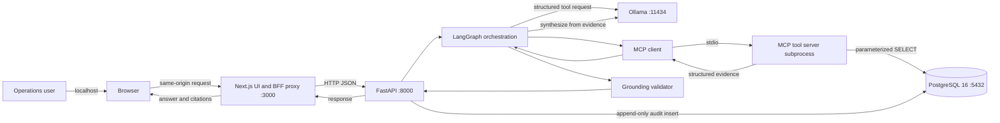
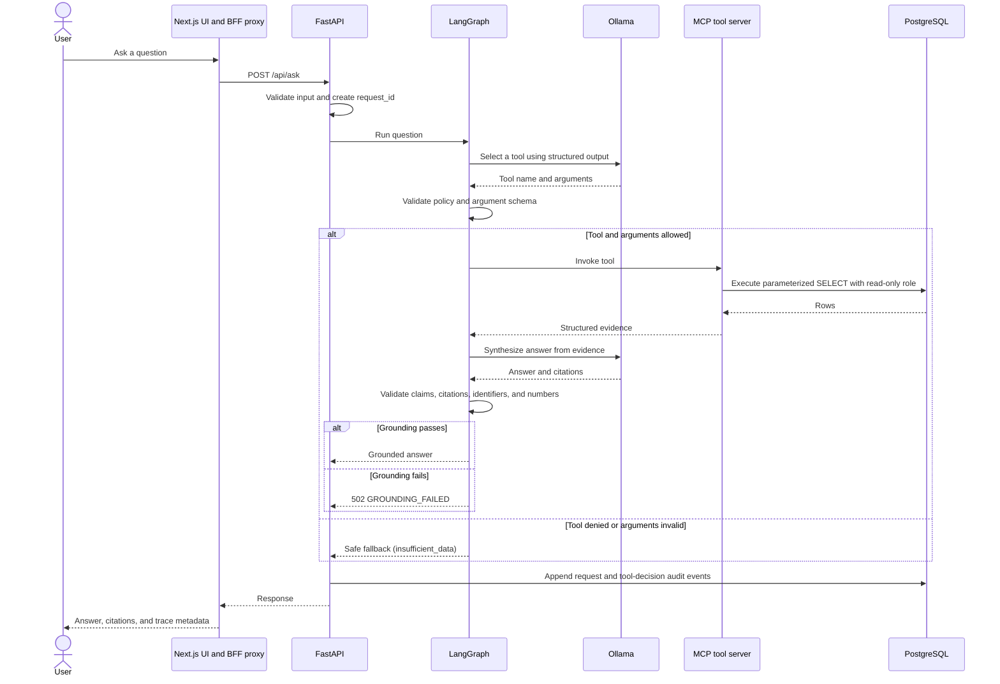
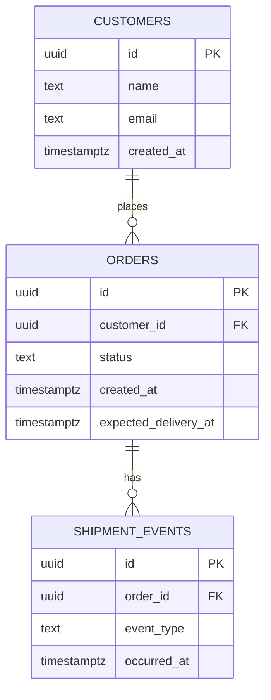

# NEXUS AI Architecture

- **Status:** Complete for Step 0.3
- **Date:** 2026-11-07
- **Scope:** MVP runtime topology, modules, data model, trust boundaries, and resource plan

## 1. Purpose

This document describes the technical design for the NEXUS AI MVP: a local-first, read-only logistics assistant that answers questions from PostgreSQL evidence through a governed tool path and a local language model.

The design is intentionally narrow. It favors a modular monolith, one local model, four read-only tools, and explicit verification over a distributed or agent-heavy architecture. It is a plan, not evidence that the system has been built or measured.

## 2. Architectural goals and constraints

### Goals

- Keep business data and inference on the local machine.
- Answer only from evidence returned by controlled tools.
- Make every request and tool decision auditable.
- Keep the MVP operable on a 16 GB Apple M1 Mac.
- Make the system testable at the domain, database, tool, API, and UI layers.
- Preserve clear seams so later capabilities can be extracted without a rewrite.

### Constraints

- No paid APIs, cloud services, hosted databases, or paid observability.
- One local model, bounded inference concurrency, and bounded request concurrency.
- Synthetic data only; no real customer or shipment data.
- Read-only tools; no consequential writes in the MVP.
- Single local user; authentication and multi-user authorization are deferred.
- PostgreSQL and Ollama are local dependencies. The previously documented Step 0.3 observation reported Ollama CLI 0.33.0 and an unavailable server, with no confirmed model. The 2026-11-07 check confirmed CLI 0.33.0 but the server probe was blocked by sandbox permissions; current server state and model availability remain unverified. See the [review evidence](STEP_0_3_REVIEW.md#environment-evidence). No Ollama benchmark exists.
- Pre-existing backend and frontend scaffolding is present, but no MVP logistics behavior or measured performance results have been verified in this review.

## 3. Runtime topology

| Component | Runtime | Port | Responsibility |
| --- | --- | --- | --- |
| Next.js UI and BFF proxy | Host-native, pnpm | `3000` | User interface and same-origin proxy to the API |
| FastAPI application | Host-native, uvicorn | `8000` | HTTP API, validation, LangGraph orchestration, MCP client, audit writes |
| MCP tool server | Local stdio subprocess managed by FastAPI | stdio | Governed, read-only tool execution |
| PostgreSQL 16 | Docker Compose, bound to `127.0.0.1` | `5432` | Operational data, read-only views, audit events |
| Ollama | Native host, Apple Metal | `11434` | Planned local model inference; candidate model `qwen3:4b` |

The application processes run on the host rather than in containers. This avoids the Docker VM memory overhead and preserves native Metal access for Ollama. Docker Compose is limited to supporting infrastructure; PostgreSQL is the only required service in the MVP. Future services such as Temporal or dbt may be added later through opt-in Compose profiles, not by default.

The MVP uses a single API process. Running multiple API workers would multiply the in-process inference semaphore and request queue, so model concurrency must still be bounded by Ollama configuration. One API worker is the simplest correct default for a single-user local system.

## 4. Architecture diagram



The browser never receives database credentials. The model receives tool schemas and evidence, not SQL authority. The MCP server is the only component that reads business data, and it does so through a read-only role over exposed views. It does not read base tables directly.

## 5. Backend module boundaries

The FastAPI backend is a modular monolith. Modules have one-way dependencies and are not separate deployables in the MVP.

```text
backend/
├── api/             HTTP routers, request/response schemas, dependency wiring
├── application/     Ask use case, orchestration, policy coordination
├── domain/          Pure order, customer, and shipment rules
├── ports/           Protocols and shared schemas for persistence, tools, model, and audit
├── persistence/     SQLAlchemy models, repositories, migrations
├── tools/           Tool registry, MCP server, read-only queries
├── llm/             Ollama client, prompts, graph nodes, structured output
└── audit/           Append-only audit writer and event definitions
```

Allowed imports:

- `domain` imports no other NEXUS module. It contains pure rules and types.
- `ports` imports only `domain` types and shared contract definitions.
- `application` imports `domain` and `ports`. It does not import adapters.
- `persistence`, `tools`, `llm`, and `audit` are adapters. They may import `domain` and `ports`, but not `api` or each other's internals.
- `api` imports `application` and wires adapters at the composition root.
- The composition root is the only place that binds ports to adapters.
- `domain` never imports `persistence`, and adapters never import `api`.

No module may import an internal implementation from a sibling module. Extraction to a separate service is allowed only at an existing module seam and requires an ADR.

## 6. End-to-end request flow



The flow is single-turn in the MVP. Clarification returns a focused follow-up question; the user submits a new question rather than relying on persisted conversation state. Conversation memory is deferred.

### 6.1 LangGraph behavior

The graph is bounded:

1. **Validate request.** Reject empty, malformed, or over-limit input before any model call.
2. **Interpret and select.** Ask the model for a structured tool selection. The model may choose only from the server-side registry.
3. **Apply policy.** Check the tool name, argument schema, customer-selector rules, limits, and query timeout before execution.
4. **Execute tool.** Call the MCP server and receive structured evidence.
5. **Synthesize.** Ask the model to produce structured claims with a natural-language answer and record-level citations, using only the evidence.
6. **Validate grounding.** Check claim coverage, citation validity, identifier presence, and server-computed numeric consistency.
7. **Respond or fail.** Return the grounded answer. On grounding-validation failure, return non-retryable `502 GROUNDING_FAILED`. Use `clarification_required` or `insufficient_data` only for ambiguity or no/empty evidence before synthesis.

Limits:

- At most one tool-selection repair attempt for malformed arguments.
- At most three sequential tool calls per request.
- No recursive agent loops and no autonomous background execution.
- A non-allowlisted tool is denied immediately and is never executed.

## 7. API surface

The MVP exposes a minimal API. Exact implementation details are deferred to M2 and M3.

### `POST /api/ask`

Request:

```json
{
  "question": "Which orders for Acme Retail are overdue?"
}
```

Response: the grounded-answer envelope defined in [REQUIREMENTS.md](REQUIREMENTS.md#51-success-and-safe-fallback-envelope). The response includes `request_id`, `status`, `answer`, `claims`, `citations`, `tool_calls`, `model`, and `latency_ms`. Each claim carries its own citations; the top-level `citations` array is the union.

### `GET /health`

Returns `200` when the API process is alive. It does not assert database or model readiness.

### `GET /ready`

Returns `200` only when the database is reachable and the expected schema is usable. Model readiness is reported separately so that a temporarily stopped model does not make the API fail liveness.

### UI boundary

The Next.js application provides the interface and a same-origin BFF proxy. The browser does not call FastAPI or PostgreSQL directly. FastAPI binds to localhost by default and rejects unexpected origins. The BFF adds no business logic; it forwards the request and preserves the response contract.

## 8. Tool contracts

All tools return a structured result with a status, data, and metadata. Domain conditions such as no matches or ambiguous customers are explicit results, not exceptions that the model must interpret.

Common result shape:

```json
{
  "status": "ok | not_found | ambiguous_customer | error",
  "data": {},
  "error": null,
  "meta": {
    "row_count": 0,
    "truncated": false,
    "evaluated_at": "2026-11-05T12:00:00Z"
  }
}
```

`evaluated_at` is produced by the database clock for time-sensitive queries. The model may describe it but must not invent it.

All customer, order, and shipment-event identifiers are UUIDs; audit-event primary keys are bigint identities. Citation `record_id` values use the typed form `<entity>:<uuid>`, where `<entity>` is `customer`, `order`, or `event`. Tool arguments such as `order_id` and `customer_id` are bare UUIDs. The type prefix must match the resource types allowed by the cited tool. Human-readable order numbers are not part of the MVP; adding one requires a contract change.

Tool result `status` values are lowercase (`ok`, `not_found`, `ambiguous_customer`, `error`). The API maps `not_found` to `NOT_FOUND`, `ambiguous_customer` to `AMBIGUOUS_CUSTOMER`, and `error` to a retryable database or model code. Tool statuses are not exposed as API error codes verbatim.

Citation compatibility is normative per tool:

| Tool | Allowed `record_id` types |
| --- | --- |
| `list_pending_orders` | `order` |
| `get_order_details` | `order`, `customer`, `event` |
| `get_overdue_orders` | `order`, `customer`, `event` |
| `get_customer_orders` | `order`, `customer` |

### Customer selector

When a customer selector is required, supply exactly one of `customer_id` (bare UUID), `customer_email`, or `customer_name`. A valid identifier selector is:

```json
{
  "customer_id": "00000000-0000-4000-8000-000000000001"
}
```

Name and email matching are exact and case-insensitive. Zero matches return `not_found`; more than one match returns `ambiguous_customer` with candidate identifiers and names. The system does not guess.

### 8.1 `list_pending_orders`

Arguments:

- `customer_selector` (optional; exactly one field if present)
- `limit` (optional integer, 1–50, default 20)

Behavior:

- Returns orders with `status = 'pending'` only.
- Orders by `created_at ASC, id ASC`.
- Fetches one extra row to determine `truncated`.
- Never includes terminal orders.

### 8.2 `get_order_details`

Arguments:

- `order_id` (required UUID)
- `event_limit` (optional integer, 1–50, default 20)

Behavior:

- Returns the order, its customer summary (`customer_id`, `name`), and shipment events ordered by `occurred_at DESC, id DESC`.
- Fetches one extra event to determine `truncated`.
- Unknown order returns `not_found` with no invented fields.

### 8.3 `get_overdue_orders`

Arguments:

- `customer_selector` (optional; exactly one field if present)
- `limit` (optional integer, 1–50, default 20)

Behavior:

- Returns non-terminal orders whose `expected_delivery_at < now()`.
- Orders by `expected_delivery_at ASC, id ASC`.
- Includes each order, its customer summary (`customer_id`, `name`), and the latest shipment event when one exists.
- Includes `is_overdue = true`, `overdue_seconds`, and `days_overdue`, computed by the backend from the database clock.
- Fetches one extra row to determine `truncated`.

### 8.4 `get_customer_orders`

Arguments:

- `customer_selector` (required; exactly one field)
- `status` (optional; one of the documented order statuses)
- `limit` (optional integer, 1–50, default 20)

Behavior:

- Returns the resolved customer summary and matching orders.
- Orders by `created_at DESC, id DESC`.
- Fetches one extra row to determine `truncated`.
- Ambiguous customer returns candidate identifiers and names, with no orders.

### 8.5 Tool policy rules

- Tool names come from a server-side registry, never from arbitrary model text.
- Arguments are validated against strict JSON schemas before execution.
- Raw SQL from the model is never executed.
- The tool role is read-only and sees only exposed views.
- Queries are parameterized.
- Row caps, column caps, and a planned `statement_timeout` of 1.5 seconds are enforced.
- Tool results contain only the fields required for the answer and citations.
- Email input is accepted for lookup but is not included in the default customer summary and is not written to audit logs in plaintext.

## 9. Grounding and response validation

The model is an untrusted component. A fluent answer is not evidence of correctness.

### Evidence rules

1. Every business fact must be derived from tool results for the current request.
2. Every citation must be a `tool + record_id` pair present in the evidence.
3. Every order, customer, or shipment-event UUID identifier in the answer must exist in the evidence.
4. Authoritative counts, overdue durations, and date calculations are computed by the backend.
5. The model may not use parametric knowledge to fill missing statuses, dates, customers, or events.
6. No tool call, empty evidence, or ambiguous intent produces `insufficient_data` or `clarification_required`, not a guess. A failed grounding validation after synthesis always returns non-retryable `502 GROUNDING_FAILED`.

### Validation stages

- **Claim coverage check:** the synthesis output is structured as claims, and every factual claim must carry at least one citation. An uncited factual claim fails grounding.
- **Citation subset check:** citations must be a subset of the evidence identifiers.
- **Identifier check:** business identifiers in the answer must use the UUID form and exist in the evidence. Human-readable order numbers are not accepted as entity identifiers.
- **Numeric consistency check:** structured numeric claims must match evidence values or deterministic calculations from cited records. Free-text numeric claims that cannot be matched are rejected.
- **Fallback:** if validation fails, the draft is discarded and the API always returns the non-retryable `GROUNDING_FAILED` error (HTTP 502). `insufficient_data` is reserved for no tool call, empty evidence, policy denial, or missing evidence before synthesis. No unverified answer is returned.

### Structured claims and residual limits

For the MVP, synthesis emits closed structured claims with `claim_type`, `subject`, `field`, `operator`, `value`, `unit`, `citations`, and an optional `text` rendering. The validator checks allowed claim types and fields for the cited resource, citation compatibility, value normalization, and zero-tolerance integers. Completeness claims are rejected when results are truncated. Prefer deterministic prose rendering from validated claims. If model-generated prose is retained, citation and identifier checks alone cannot certify it; report that residual risk and evaluate the prose separately.

Claim fields are normative per claim type and subject:

| Claim type | Subject | Allowed fields | Required citations | Allowed operators |
| --- | --- | --- | --- | --- |
| `record_existence` | `customer` | none | `customer` | `exists` |
| `record_existence` | `order` | none | `order` | `exists` |
| `record_existence` | `event` | none | `event` | `exists` |
| `field_equality` | `customer` | `name` | `customer` | `eq`, `neq` |
| `field_equality` | `order` | `status` | `order` | `eq`, `neq` |
| `field_equality` | `event` | `event_type` | `event` | `eq`, `neq` |
| `status` | `order` | `status` | `order` | `eq`, `in` |
| `timestamp` | `order` | `created_at`, `expected_delivery_at` | `order` | `eq`, `lt`, `lte`, `gt`, `gte` |
| `timestamp` | `event` | `occurred_at` | `event` | `eq`, `lt`, `lte`, `gt`, `gte` |
| `count` | `order` | `row_count` | `order` | `eq`, `gte`, `lte` |
| `overdue_calculation` | `order` | `is_overdue`, `overdue_seconds`, `days_overdue` | `order` | `eq`, `gt`, `gte` |
| `latest_event` | `order` | `event_type`, `occurred_at` | `order`, `event` | `eq`, `lte` |

Fields, subjects, and operators not listed for the exact claim type are rejected. Every required citation must be present in the claim and allowed by the cited tool. Bind the claim subject and value to the exact cited record; validate customer-to-order and event-to-order relationships, not merely that both UUIDs occur somewhere in the evidence. Units must match the field: boolean for `is_overdue`, seconds for `overdue_seconds`, days for `days_overdue`, and null otherwise.

Absence is not represented as a structured claim. A zero-row result returns `insufficient_data` with empty `claims` and `citations`; the evaluation harness separately checks that no factual claim was emitted and records `row_count=0`, `truncated=false`, and `evaluated_at` from the tool metadata.

This validator does not prove full semantic entailment of arbitrary prose. It does not detect paraphrases, aliases, omitted facts, negative or causal language, advice, or every completeness error unless those are represented as structured claims. Evaluation must measure schema validity, citation validity, claim-field support, unsupported claims, hallucinated identifiers and numbers, safe fallback, and false refusal on seeded adversarial cases. Include valid citations paired with a wrong status, swapped customer/order or event/order associations, unsupported causal explanations, negation, and false completeness with truncated results. Compare structured fields and relationships against seeded expected values; separately review free-text entailment against evidence with recorded human labels. Report structured validation and prose-support results separately, including failures and false refusals. A passing finite test set does not prove semantic truth for arbitrary prose.

## 10. Data model

### 10.1 Entity relationships



### 10.2 Initial schema

PostgreSQL 16 is the planned MVP database. pgvector is deferred and is not part of the initial schema. `gen_random_uuid()` is available in PostgreSQL 16 without an additional extension.

```sql
CREATE TABLE customers (
    id uuid PRIMARY KEY DEFAULT gen_random_uuid(),
    name text NOT NULL CHECK (length(btrim(name)) BETWEEN 1 AND 200),
    email text NOT NULL CHECK (position('@' in email) > 1),
    created_at timestamptz NOT NULL DEFAULT now()
);

CREATE UNIQUE INDEX customers_email_lower_uidx
    ON customers (lower(email));

CREATE INDEX customers_name_lower_idx
    ON customers (lower(name));

CREATE TABLE orders (
    id uuid PRIMARY KEY DEFAULT gen_random_uuid(),
    customer_id uuid NOT NULL REFERENCES customers (id) ON DELETE RESTRICT,
    status text NOT NULL
        CHECK (status IN ('pending', 'confirmed', 'in_transit', 'delivered', 'cancelled')),
    created_at timestamptz NOT NULL DEFAULT now(),
    expected_delivery_at timestamptz NOT NULL,
    CHECK (expected_delivery_at >= created_at)
);

CREATE INDEX orders_pending_idx
    ON orders (created_at ASC, id ASC)
    WHERE status = 'pending';

CREATE INDEX orders_overdue_idx
    ON orders (expected_delivery_at ASC, id ASC)
    WHERE status NOT IN ('delivered', 'cancelled');

CREATE INDEX orders_customer_created_idx
    ON orders (customer_id, created_at DESC, id DESC);

CREATE TABLE shipment_events (
    id uuid PRIMARY KEY DEFAULT gen_random_uuid(),
    order_id uuid NOT NULL REFERENCES orders (id) ON DELETE RESTRICT,
    event_type text NOT NULL
        CHECK (event_type IN ('created', 'picked_up', 'in_transit', 'out_for_delivery', 'delivered', 'exception')),
    occurred_at timestamptz NOT NULL
);

CREATE INDEX shipment_events_order_occurred_idx
    ON shipment_events (order_id, occurred_at DESC, id DESC);

CREATE TABLE audit_events (
    id bigint GENERATED ALWAYS AS IDENTITY PRIMARY KEY,
    request_id uuid NOT NULL,
    event_type text NOT NULL
        CHECK (event_type IN ('request', 'tool_decision', 'grounding', 'error')),
    actor_id text NOT NULL DEFAULT 'local',
    tool_name text,
    args_hash text,
    decision text CHECK (decision IN ('allowed', 'denied', 'completed', 'error')),
    row_count integer CHECK (row_count >= 0),
    latency_ms integer CHECK (latency_ms >= 0),
    model text,
    error_code text,
    created_at timestamptz NOT NULL DEFAULT now()
);

CREATE INDEX audit_events_request_idx
    ON audit_events (request_id, created_at ASC);

CREATE INDEX audit_events_created_idx
    ON audit_events (created_at ASC);
```

### 10.3 Read-only views and roles

The tool server does not read base tables directly. It reads narrowly scoped views through a dedicated read-only role.

```sql
CREATE VIEW v_customers AS
    SELECT id, name, email FROM customers;

CREATE VIEW v_orders AS
    SELECT id, customer_id, status, created_at, expected_delivery_at FROM orders;

CREATE VIEW v_shipment_events AS
    SELECT id, order_id, event_type, occurred_at FROM shipment_events;
```

`v_customers` exposes `email` only to support exact customer lookup. Tool results must omit email unless the user explicitly requests it, and logs and audit records omit it by default. If that exposure is unacceptable, split a lookup view before M1.4.

Role intent:

- `nexus_owner`: migration and schema owner; not used by the running application.
- `nexus_tool`: `SELECT` only on `v_customers`, `v_orders`, and `v_shipment_events`; no access to base tables, audit, or migrations.
- `nexus_app`: `INSERT` on `audit_events`; no `UPDATE` or `DELETE`; no business-table reads for LLM flows.
- The tool path uses `nexus_tool`; the API uses `nexus_app` for audit writes.

The [M1.4 preparation plan](../backend/security/README.md) refines these intents:
`nexus_owner` stays `NOLOGIN`; runtime roles start disabled and have no memberships.
Views use explicit owner-rights security with schema-qualified sources. They expose
all rows in their projections, including customer email, and do not provide tenant
isolation. Audit insertion is limited to writer columns excluding generated `id`;
writers omit `RETURNING`, and receive no sequence privileges. These controls are
prepared source, not deployed permissions. Target database grants do not remove
PUBLIC CONNECT/TEMP inherited in other databases; runtime LOGIN activation requires
explicit acceptance of that scope or a separately approved isolation design.

The application roles cannot update or delete audit events, so API writes are append-only in normal operation. This is not an absolute guarantee against the table owner or a database superuser. A production-grade deployment would also review ownership, row-level security, and audit retention and deletion.

## 11. Business rules

### 11.1 Order statuses

The initial status set is:

- `pending`
- `confirmed`
- `in_transit`
- `delivered`
- `cancelled`

Terminal statuses are `delivered` and `cancelled`. Terminal orders are excluded from pending and overdue results.

### 11.2 Overdue definition

An order is overdue when all of the following are true:

1. `status NOT IN ('delivered', 'cancelled')`
2. `expected_delivery_at IS NOT NULL` (the MVP requires it)
3. `expected_delivery_at < now()` using the database clock

An `expected_delivery_at` exactly equal to the database timestamp is not overdue. The comparison is strict. All timestamps are stored as `timestamptz` in UTC; no client clock is trusted.

`overdue_seconds` is the floored elapsed seconds between `now()` and `expected_delivery_at`. `days_overdue` is the floored number of complete 24-hour periods. An order that is 30 minutes late is overdue with `days_overdue = 0`.

### 11.3 Latest shipment event

The latest event is the row with the greatest `occurred_at` for the order. Ties are broken by the greatest `id`. The latest event is a summary fact, not a claim that no later event exists outside the stored data.

### 11.4 Pending orders

`list_pending_orders` matches exactly `status = 'pending'`. It does not treat `confirmed` or `in_transit` as pending. This is deliberate and must remain consistent across tools and tests.

### 11.5 Row limits and truncation

Each list tool returns at most 50 rows and defaults to 20. The tool fetches one extra row to set `truncated`. A truncated result is evidence of a bounded response, not a complete inventory. The answer must not imply completeness when `truncated = true`.

### 11.6 Customer resolution

Exactly one selector field may be present. Name and email comparisons use exact, case-insensitive matching. Zero matches return `not_found`. Multiple matches return `ambiguous_customer` with candidate identifiers and names. Fuzzy matching is not used in the MVP.

## 12. Trust boundaries and security

### 12.1 Boundaries

1. **Browser:** untrusted input; no database credentials; no direct database access.
2. **Next.js BFF:** local trusted proxy; no business logic; forwards validated requests.
3. **FastAPI:** validates input, orchestrates the graph, enforces deadlines, writes audit events.
4. **Model:** untrusted output; may propose tools and text, but cannot execute SQL or bypass policy.
5. **MCP server:** policy enforcement point; owns the tool registry and read-only query path.
6. **PostgreSQL:** system of record; separate roles for reading, audit insertion, and migrations.

### 12.2 Controls

- Bind FastAPI and PostgreSQL to `127.0.0.1` by default.
- Keep direct browser access out of the MVP. If a future design adds it, restrict CORS to the local UI origin and record the change.
- Deny-by-default tool access with four allowlisted tools.
- Validate arguments with strict schemas and reject unknown fields.
- Parameterize every query; never interpolate model text into SQL.
- Use a read-only role over exposed views for tool queries.
- Cap rows, columns, event counts, and statement duration.
- Redact secrets and minimize PII in logs and audit.
- Store no raw model prompts or raw customer arguments in the audit table by default; use normalized argument hashes.
- Fail closed if audit cannot be written.

### 12.3 Future writes

The MVP has no write tools. Any future consequential write must use:

```text
propose → policy check → human approval record → short-lived approval token
→ idempotent execution → append-only audit
```

The proposer and approver must be separate responsibilities. No write tool may exist without an approval record and an audit path. This is deferred and requires a new ADR.

## 13. Error handling and failure isolation

| Condition | Behavior |
| --- | --- |
| Empty, malformed, or over-limit input | `422 INVALID_INPUT`; no model call |
| Non-allowlisted tool | Deny, audit, safe fallback; never execute |
| Invalid tool arguments | One repair attempt; then safe fallback and audit |
| Empty result | `200 insufficient_data` with a clear "no matching records" message; no invented citations |
| Ambiguous customer | `clarification_required` with candidate identifiers; no order query |
| Unsupported question | `clarification_required`; no arbitrary query |
| Database timeout | `503 DB_TIMEOUT`, retryable; no partial answer |
| Database error | `503 DB_ERROR`, retryable; no partial answer |
| Model timeout | `503 MODEL_TIMEOUT` after bounded retry |
| Model unavailable | `503 MODEL_UNAVAILABLE` |
| Saturation | `429 RATE_LIMITED` with `Retry-After` |
| Grounding failure | `502 GROUNDING_FAILED`; discard draft |
| Audit write failure | `503 AUDIT_WRITE_FAILED`; fail closed |

Planned deadlines are design defaults, not measured results: 1.5 seconds per database statement, roughly 30 seconds for model interaction, and a total request deadline in the 30–45 second range. The total request deadline is a timeout, not a performance target; NFR-003's 30-second p95 target is separate. The M5 evaluation must replace these intentions with measured values.

## 14. Resource budget for 16 GB

These are additive planning estimates, not measurements. Reserve is required headroom, not consumed memory; totals including reserve express required capacity. “Baseline” below means the low-end full-stack planning scenario, not measured idle-host usage. “Worst case” means the high-end planning scenario, not an exhaustive upper bound. They must be validated on the target machine before the project claims the system fits. Docker VM overhead and the PostgreSQL container estimate may overlap, so the totals are conservative.

| Item | Estimate |
| --- | ---: |
| macOS and baseline applications | 4–6 GB |
| Ollama `qwen3:4b` Q4 weights | ~2.5 GB |
| KV cache and model runtime (4k–8k context) | 1–2 GB |
| PostgreSQL container | 0.5–1 GB |
| FastAPI and MCP server | 0.2–0.5 GB |
| Next.js development process | 0.5–1.5 GB |
| Docker VM overhead | 1–2 GB |
| Reserve | 2–3 GB |

Load before reserve is 9.7–15.5 GB. Adding reserve gives 11.7–18.5 GB.

| Scenario | Method | Estimate |
| --- | --- | ---: |
| Baseline full stack | low ends + 2 GB reserve | ~11.7 GB |
| Typical full stack | midpoints + 2.5 GB reserve | ~15.1 GB |
| Typical load only | midpoints before reserve | ~12.6 GB |
| Worst case | high ends + 3 GB reserve | ~18.5 GB |

The earlier “roughly 12–15 GB peak” described a typical planning band, not a guaranteed upper bound. The worst-case additive estimate exceeds 16 GB. A 16 GB fit is conditional and must be measured; it is not a claim.

Required measurements before a fit claim:

1. Idle host memory and macOS memory pressure, including swap and compression.
2. Docker VM and PostgreSQL container memory, if Docker is used.
3. FastAPI, MCP, and Next.js RSS during a representative request.
4. Ollama loaded weights and KV-cache memory at the chosen context window.
5. Peak total during one in-flight request with one loaded model and the documented concurrency limits.
6. The same measurements at M5, with commands, environment, and observed output recorded.

If measured total leaves less than 2 GB reserve, or macOS reports sustained memory pressure, apply a fallback and record it: reduce the context window, use a smaller quantized model, stop the Next.js development server during model-heavy evaluation, or move PostgreSQL to a native installation. These are fallbacks, not current decisions. The design therefore uses:

- one loaded model;
- `OLLAMA_NUM_PARALLEL=1`;
- one API worker;
- inference concurrency 1;
- API concurrency 2–4 with a small in-process queue;
- a bounded context window;
- at most three sequential tool calls;
- a small database connection pool.

## 15. Observability and operations

- Structured logs include `request_id`, tool decision, row count, latency, model identifier, and error code.
- The audit table is the durable record for request and tool activity.
- `/health` checks liveness only.
- `/ready` checks database reachability and schema usability.
- Model readiness is checked through a separate local probe and does not fail API liveness.
- No paid observability service is required. No Prometheus, Grafana, or log aggregation stack is part of the MVP.
- The local environment is not started automatically. Dependency installation, model download, Docker startup, commits, and pushes require explicit approval.

## 16. Scalability and evolution

The MVP is optimized for one user and one machine. It is not horizontally scalable, and that is an explicit trade-off.

The likely evolution path is:

1. Keep the modular monolith while adding MCP tools and evaluation.
2. Add pgvector and local embeddings for document retrieval if the product needs it.
3. Add durable workflows with Temporal for long-running follow-ups.
4. Add dbt Core for local transformations and data-quality tests.
5. Add scikit-learn and MLflow for local experimentation.
6. Add authentication and multi-user authorization before any shared deployment.

Extraction is allowed only at existing module seams and only with an ADR. A microservice split is not an MVP goal.

## 17. Key decisions and ADRs

- [ADR-0001: Local-first runtime topology](adr/0001-local-first-runtime-topology.md) — host-native application processes, containerized PostgreSQL, and a modular monolith.
- [ADR-0002: Local dependencies and trust boundaries](adr/0002-local-dependencies-and-trust-boundaries.md) — a local stdio MCP server as the only governed data-access path, with strict trust and audit boundaries.

Both records are proposals. They are not accepted decisions until the project owner approves them.

## Assumptions and unresolved decisions

### Assumptions

- Single local user and a single Mac.
- Single-turn questions; no persisted conversation memory in the MVP.
- Synthetic data is sufficient.
- Exact customer matching is sufficient.
- PostgreSQL in Docker Compose and Ollama natively on macOS are acceptable, subject to measured memory fit.
- `qwen3:4b` is only a candidate; no model was confirmed available or evaluated. The latest sandbox-blocked probe does not establish model inventory.
- The model can produce structured tool selections reliably enough to be validated, but this is unproven.
- The 16 GB fit is conditional: the planning typical estimate is near 15 GB and the worst-case estimate exceeds 16 GB, so measured reserve and fallbacks are required.
- The initial statuses and event types are business assumptions, not final contracts.
- `expected_delivery_at` is required and cannot precede `created_at` for MVP data.

### Unresolved decisions

- Final order-status and shipment-event enums.
- Authentication, actor identity, and local-network exposure.
- PII minimization, masking, and retention policy.
- Audit retention and deletion policy.
- Exact performance targets and reference workload.
- Model selection after evaluation.
- Grounding validator depth and evaluation thresholds.
- Clarification flow across turns.
- UI presentation of citations and candidate customers.
- Production deployment and backup strategy.

## 18. Related documents

- [README](../README.md)
- [Product vision](PRODUCT_VISION.md)
- [Requirements](REQUIREMENTS.md)
- [Roadmap](ROADMAP.md)
- [ADR index](adr/README.md)
