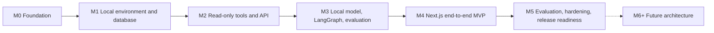

# NEXUS AI Roadmap

- **Status:** Complete for Step 0.3
- **Date:** 2026-11-07
- **Scope:** MVP sequencing, exit criteria, and requirement traceability

## 1. Purpose

This roadmap sequences the NEXUS AI MVP by dependency. It is not a calendar commitment and it does not claim that any milestone has been implemented. Each milestone has a clear goal, deliverables, dependencies, exit criteria, and a set of requirements it must satisfy.

The sequence is intentionally linear. The target machine has 16 GB of unified memory, and the MVP should avoid running multiple experimental stacks at once.

## 2. Sequencing principles

1. **Foundation before application code.** Schema, roles, data, and test scaffolding come before the assistant.
2. **Tools before the model.** Deterministic tool behavior must be testable without an LLM.
3. **One model, one graph, one readable path.** Do not add secondary models, agents, or services before the core path is measured.
4. **Evidence before automation.** Read-only answers must be grounded and evaluated before any write or workflow capability is considered.
5. **No hidden expansion.** A milestone does not absorb deferred features without a new approved scope and, where material, an ADR.
6. **No unverified claims.** A milestone is complete only when its exit criteria were executed and observed.

## 3. Milestone overview

| Milestone | Focus | Status |
| --- | --- | --- |
| M0 | Product and architecture foundation | Documentation complete (Step 0.3) |
| M1 | Local environment and database foundation (M1.1–M1.5) | M1.1–M1.2 PASS; M1.3 PASS (isolated database); M1.4 preparation only; M1.5 planned |
| M2 | Read-only tools and FastAPI API | Planned |
| M3 | Local LLM, LangGraph, and MCP integration | Planned |
| M4 | Next.js end-to-end MVP | Planned |
| M5 | Evaluation, hardening, and release readiness | Planned |
| M6+ | Future architecture and automation | Deferred |

## 4. M0 — Product and architecture foundation

### Goal

Establish a coherent, testable product and architecture direction before any application code exists.

### Deliverables

- Root `README.md` with product, architecture, roadmap, and repository overview.
- `docs/PRODUCT_VISION.md` with problem, users, value, scenario, and scope.
- `docs/REQUIREMENTS.md` with functional and nonfunctional requirements, acceptance criteria, and future requirements.
- `docs/ARCHITECTURE.md` with runtime topology, modules, data flow, tool contracts, schema, trust boundaries, and resource plan.
- `docs/ROADMAP.md` with milestones, dependencies, exit criteria, and requirement traceability.
- Proposed [ADR-0001](adr/0001-local-first-runtime-topology.md) and [ADR-0002](adr/0002-local-dependencies-and-trust-boundaries.md).
- Updated [ADR index](adr/README.md).
- Link, cross-reference, and traceability checks.
- Focused read-only review by the `reviewer` subagent.

### Dependencies

None.

### Exit criteria

- All listed documents exist and cross-links resolve.
- Every MVP FR and NFR appears in the traceability matrix.
- ADR-0001 and ADR-0002 are present as proposals and are linked from the architecture and README.
- This documentation review creates no application source, dependencies, database services, or models. Pre-existing scaffolding is recorded separately and does not demonstrate completion of M1.1.
- The documents distinguish planning estimates from measured results.
- The memory plan distinguishes baseline, typical, and worst-case estimates; the worst case is not presented as fitting 16 GB without measurement.
- Identifier examples use UUIDs, and M1 is split into M1.1–M1.5 with per-step verification.
- Grounding limits, structured-claim evaluation, and the distinction between Ollama CLI, server, and model availability are explicit.
- A focused reviewer pass reports no unresolved material inconsistency, or material findings are recorded and corrected.
- The next milestone is not started without explicit approval.

### Requirement coverage

- NFR-001: local-first and no paid runtime services are stated as binding constraints.
- NFR-002: the 16 GB constraint and resource plan are documented.
- NFR-010: the modular-monolith boundary is documented.
- NFR-014: the evaluation and truthfulness rules are established before measurement.

## 5. M1 — Local environment and database foundation

### Goal

Create a reproducible local PostgreSQL environment, the initial schema, read-only views and roles, synthetic data, and the first executable tests.

M1 is the parent gate. It is delivered in five ordered sub-milestones. M1 is complete only when all five sub-milestones and the aggregate exit criteria are verified.

### M1.1 — Repository and tooling

M1.1 implementation was explicitly authorized after Step 0.3. Existing backend/frontend scaffolding and the Makefile were preserved and completed within the tooling scope. The owner approved dependency installation and Git initialization; both application lockfiles now exist. Pinned lint/typecheck/smoke checks and a Webpack production build pass; default Turbopack is blocked by local worker-port restrictions. The final independent reviewer approved with comments: **M1.1 PASS with the documented Webpack fallback and warnings**. See [M1.1 verification evidence](M1_1_VERIFICATION.md). M1.2 authorized runtime checks, host protocol probing and normal-restart persistence passed; independent review approved with comments: **M1.2 PASS**.

Deliverables:

- Repository layout for backend, frontend, tests, and local infrastructure.
- Pinned tool and dependency versions at implementation time.
- `.env.example` containing placeholders only; no real credentials.
- Executed and recorded scaffold test/lint commands. Migration and service commands are deferred to M1.2/M1.3; any early examples must be labeled planned and unverified.
- No application behavior beyond scaffolding.

Verification:

- Repository inventory confirms the documented layout and no tracked secrets.
- Execute and record the documented test-discovery or scaffold smoke-test command and lint command for each scaffolded package; record missing tools as blockers rather than installing without approval.
- `.env.example` contains placeholders only.

Exit criteria:

- Layout and developer commands are documented.
- No real credentials or personal data are tracked.
- Test and lint entry points exist, run successfully, and have recorded commands and observed output.

Requirement coverage: NFR-004, NFR-008, NFR-010, NFR-011.

### M1.2 — PostgreSQL infrastructure

Status: authorized setup, Compose validation, health/authenticated SQL, direct host reachability, localhost binding, volume attachment, normal-restart persistence and M1.1 regressions **PASS**. Independent final read-only review approved with comments and no unresolved material finding: **M1.2 PASS**. See [M1.2 evidence](M1_2_VERIFICATION.md).

Deliverables:

- Docker Compose service for PostgreSQL 16, bound to `127.0.0.1:5432`, with a named volume and healthcheck.
- Local-only exposure by default.
- Documented startup, non-destructive shutdown, status, logs and readiness commands; destructive reset is excluded from M1.2 and requires a separate explicit owner-approved task.

Verification:

- Compose configuration validates.
- When started with approval, the healthcheck passes and the port binding is local-only.
- After explicit execution and normal-restart approval, verify that an isolated non-application persistence marker survives the restart. Do not delete volumes or run reset commands in M1.2.

Exit criteria:

- Compose configuration validates; after explicit approval, PostgreSQL becomes healthy, host loopback connectivity and volume attachment are verified, and a marker survives an approved normal restart. Exact executed commands and output are recorded.
- No service is exposed beyond localhost by default.
- No real credentials are committed.

Requirement coverage: NFR-004, NFR-005 foundation, NFR-011.

### M1.3 — Domain schema and migrations

Status: authorized dependency installation, metadata/revision validation, isolated upgrade/catalog/constraint/reversal and regression checks **PASS**. Independent final review approved with comments and no unresolved material finding: **M1.3 PASS for the authorized isolated scope**. nexus_m13_test remains at head with empty application tables; nexus_ai and nexus_m12_verify remain unchanged. See [M1.3 verification](M1_3_VERIFICATION.md).

Deliverables:

- Alembic migrations for `customers`, `orders`, `shipment_events`, and `audit_events`.
- UUID primary keys for customers, orders, and shipment events; bigint identity primary key for audit events; foreign keys, status checks, event-type checks, required timestamps, and indexes.
- Initial enums or constraints as documented.

Verification:

- `alembic upgrade head`, downgrade, and re-upgrade pass with observed output.
- Constraint tests reject orphan foreign keys and invalid statuses or event types.
- Required indexes exist.

Exit criteria:

- Migrations apply and roll back cleanly on a clean database.
- Constraints and indexes are enforced by tests.
- Schema matches the architecture data model.

Requirement coverage: FR-014 schema foundation, NFR-004, NFR-007, NFR-011.

### M1.4 — Database security, views and roles

Preparation and execution are separate gates. See [M1.4 preparation evidence](M1_4_VERIFICATION.md)
and [security deployment plan](../backend/security/README.md). Prepared SQL/tests do not
satisfy the runtime exit criteria below. Deployment, credential creation and live
permission tests remain subject to separate owner approval; M1.5 remains unstarted.

Deliverables:

- Read-only views `v_customers`, `v_orders`, and `v_shipment_events`.
- Roles for migration ownership, read-only tool access, and append-only audit insertion.
- Grants for append-only audit insertion.
- Documented email exposure and lookup-view decision.

Verification:

- `nexus_tool` can select from the exposed views but cannot select base tables, audit, or migration objects.
- `nexus_tool` cannot insert, update, or delete business data.
- `nexus_app` can insert audit events but cannot update or delete them.
- Role smoke tests record unexpected grants.

Exit criteria:

- Least-privilege grants are enforced and documented.
- Audit insertion is append-only for application roles.
- Privileged-owner limitations and the retention policy remain documented.

Requirement coverage: FR-010 foundation, FR-012 foundation, NFR-004, NFR-005, NFR-006 foundation, NFR-011.

### M1.5 — Synthetic data and integration tests

Deliverables:

- Deterministic, idempotent synthetic seed data.
- Domain unit tests for order and customer rules.
- PostgreSQL integration tests for constraints, indexes, views, and role permissions.
- Recorded test commands and outputs.

Verification:

- Seed twice and compare row counts and checksums.
- Integration tests pass with observed output.
- Tests cover allowed and denied role operations.

Exit criteria:

- The seed is idempotent: running it twice does not duplicate records.
- Domain and integration tests pass with observed output.
- No secrets or real personal data are committed.

Requirement coverage: FR-010 foundation, FR-012, FR-014, NFR-004, NFR-005, NFR-006, NFR-008, NFR-011.

### Dependencies

M0 complete and approved. Sub-milestones are ordered; each depends on the prior sub-milestone.

### Aggregate exit criteria

- M1.1–M1.5 complete with recorded evidence.
- `docker compose up` and migration commands work locally and are documented after execution.
- `nexus_tool` can select from the exposed views but cannot insert, update, or delete business data.
- `nexus_tool` cannot read `audit_events`, base tables, or migration objects. Any future grant change requires an ADR and updated role tests.
- `nexus_app` can insert audit events but cannot update or delete them.
- Foreign keys, status checks, event-type checks, and required timestamps are enforced.
- Integration tests for the schema and roles pass with observed output.
- No secrets or real personal data are committed.

### Requirement coverage

- FR-010: read-only database role and parameterized-access foundation.
- FR-012: append-only audit grant foundation.
- FR-014: schema, migrations, and synthetic data.
- NFR-004: local data and secrets handling.
- NFR-005: least-privilege roles and parameterized-access foundation.
- NFR-006: audit append-only foundation.
- NFR-007: deterministic schema constraints and business rules.
- NFR-008: domain and integration test foundation.
- NFR-010: module layout and dependency direction.
- NFR-011: reproducible local environment.

## 6. M2 — Read-only tools and FastAPI API

### Goal

Implement the governed tool path and the API shell without requiring a language model. The four tools and all policy/error semantics must be testable deterministically.

### Deliverables

- MCP tool server using the MCP Python SDK over local stdio.
- Server-side tool registry with strict JSON schemas for:
  - `list_pending_orders`
  - `get_order_details`
  - `get_overdue_orders`
  - `get_customer_orders`
- Customer selector validation, ambiguity results, and deterministic ordering.
- Query limits, row caps, column caps, and statement timeout.
- FastAPI endpoints for `GET /health` and `GET /ready`, plus reusable request-validation and error types.
- Response/error contract types prepared for the M3 ask endpoint.
- Append-only audit writer and fail-closed behavior.
- Structured logs with request identifiers and tool decisions.
- Tool contract tests, API tests, policy-denial tests, and database-failure tests.

### Dependencies

M1 complete and approved.

### Exit criteria

- All four tools return the documented result shapes for valid, empty, not-found, and ambiguous inputs.
- The tool cannot execute raw SQL from a model or caller.
- Non-allowlisted tools are denied before execution and audited.
- Unknown or invalid arguments are rejected before query execution.
- The read-only role is enforced in tests, not just by convention.
- Database timeouts and errors map to the documented error codes with no partial answer.
- Audit write failure prevents a response from being returned as successful.
- Health and readiness endpoints behave as documented.
- Tool and API tests pass with observed output.

### Requirement coverage

- FR-003, FR-004, FR-005, FR-006, FR-007: tool behavior.
- FR-010: deterministic tool contracts.
- FR-011: API and error handling.
- FR-012: append-only audit.
- FR-013: request traceability.
- FR-015: health and readiness.
- NFR-004: local data boundary for API and tool execution.
- NFR-005: least-privilege execution.
- NFR-006: auditable activity.
- NFR-007: deterministic query and business rules.
- NFR-008: tool and API tests.
- NFR-009: local observability.
- NFR-013: failure isolation and fail-closed behavior.

## 7. M3 — Local LLM, LangGraph, and MCP integration

### Goal

Connect the local model to the governed tool path, add grounded answer synthesis, and establish a truthful evaluation harness. This is the highest-risk milestone because model behavior and 16 GB memory pressure are unproven.

### Deliverables

- Ollama local client and model readiness probe.
- Candidate model evaluation for `qwen3:4b` and any approved alternatives.
- FastAPI `POST /api/ask` endpoint that runs the LangGraph flow and returns the documented response envelope.
- LangGraph for input validation, tool selection, policy handoff, tool execution, synthesis, grounding validation, and safe fallback.
- Structured tool-selection output with one bounded repair attempt.
- Grounding validator for claim-to-citation coverage, allowed structured claim types and fields, per-tool citation compatibility, identifier presence, and server-computed numeric consistency.
- Synthetic evaluation question set covering:
  - each of the four tools;
  - ambiguous customers;
  - empty results;
  - unsupported questions;
  - database and model failure paths;
  - seeded adversarial invalid claims and hallucinated identifiers or numbers.
- Recorded model-selection evidence, including actual resource and memory observations for baseline, typical, and worst-case scenarios.
- Evaluation report template that records commands, environment, outputs, and limitations.

### Dependencies

M2 complete and approved; explicit approval to download and run a local model.

### Exit criteria

- `POST /api/ask` validates input before any model call and returns the documented response or error envelope.
- The selected model is recorded with the basis for selection. No benchmark is claimed without a recorded run.
- The model can select the correct tool for a defined synthetic set, and the measured result is recorded.
- Invalid tool calls are rejected and repaired at most once before safe fallback.
- Every factual claim has at least one valid citation, and all citations reference evidence returned for the request.
- Claim coverage, citation subsets, allowed claim fields, identifiers, and server-computed values pass the validator on the evaluation set, with failures recorded rather than hidden.
- The evaluation reports schema validity, claim-field and relationship support, unsupported claims, hallucinated identifiers and numbers, safe fallback, and false refusal on the seeded set. Record human-reviewed prose support separately; include correct citations attached to wrong facts, swapped entities, causal/negative prose, and truncated-result completeness errors.
- Ambiguous, empty, and unsupported questions produce safe fallbacks rather than invented facts.
- Evaluation results include actual latency and resource notes.
- The memory observation records baseline, typical, and worst-case totals and states whether at least 2 GB reserve remains. If it does not, the fallback is recorded; no fit claim is made.
- No paid service is used.

### Requirement coverage

- FR-001: question acceptance and response envelope.
- FR-002: governed local tool selection.
- FR-008: grounded answers and citations.
- FR-009: ambiguity and insufficient evidence.
- FR-011: model and grounding error handling.
- FR-016: evaluation harness.
- NFR-002: memory validation.
- NFR-003: provisional performance measurement.
- NFR-004: local inference and data boundary.
- NFR-007: deterministic calculation and low model discretion.
- NFR-008: evaluation and integration tests.
- NFR-013: model, tool, and grounding failure isolation.
- NFR-014: truthful evaluation results.

## 8. M4 — Next.js end-to-end MVP

### Goal

Deliver the single-user UI that makes the governed answer, citations, and failure states understandable end to end.

### Deliverables

- Next.js App Router UI with a question input and answer view.
- Same-origin BFF proxy to FastAPI; no direct browser-to-database path.
- Citation display with record identifiers and tool provenance.
- Clarification display with candidate customer identifiers.
- Loading, empty, error, retryable, and insufficient-data states.
- Keyboard-accessible citation and clarification controls.
- End-to-end tests for the primary overdue-orders scenario and failure states.
- Local run instructions recorded only after execution.

### Dependencies

M3 complete and approved.

### Exit criteria

- The primary scenario from the product vision works end to end: question, tool call, grounded answer, citations, and trace metadata.
- The UI does not expose database credentials or provider secrets.
- The browser does not call PostgreSQL directly.
- Ambiguous and empty results render safely and do not imply invented facts.
- Error states distinguish retryable from non-retryable failures.
- Accessibility checks for the implemented controls pass.
- End-to-end tests pass with observed output.

### Requirement coverage

- FR-001: UI submission and response display.
- FR-009: clarification and insufficient-data presentation.
- FR-013: trace metadata.
- NFR-008: end-to-end tests.
- NFR-012: understandable and accessible UI.

## 9. M5 — Evaluation, hardening, and release readiness

### Goal

Prove the MVP on the target machine, close material security and reliability gaps, and produce an honest release-readiness report. This milestone is evidence collection, not feature expansion.

### Deliverables

- Full evaluation run over the synthetic question set with recorded commands and outputs.
- Measured end-to-end latency, tool latency, model latency, and baseline/typical/worst-case memory observations on the target Mac.
- Security review covering input validation, tool policy, database roles, secrets, local exposure, and dependency risk.
- Reliability tests for timeouts, unavailable model, database failure, grounding failure, and audit failure.
- Written audit retention and deletion policy that preserves append-only behavior and defines the MVP retention period.
- Final documentation update with actual commands, results, and known limitations.
- Release-readiness checklist.
- Explicit list of unmet requirements, if any.

### Dependencies

M4 complete and approved.

### Exit criteria

- Every MVP requirement is either verified or explicitly listed as unmet with a reason.
- The final evaluation reports schema validity, claim-field support, unsupported claims, hallucinated identifiers and numbers, safe fallback, and false refusal.
- Results are based on executed commands; no metric is copied from an expectation.
- The primary scenario works on the target machine.
- Memory fit is validated for baseline, typical, and worst-case scenarios, or the limitation is documented with a concrete fallback.
- The system uses no paid runtime service.
- No secrets or real customer data are present in tracked files.
- Read-only enforcement, audit fail-closed behavior, and grounding fail-closed behavior (`502 GROUNDING_FAILED`, no partial answer) are verified.
- The audit retention and deletion policy states a concrete retention period and explains how deletion is reconciled with append-only grants.
- Documentation matches observed behavior.
- A final review finds no unresolved material issue, or remaining issues are explicitly accepted.

### Requirement coverage

- FR-008: final groundedness verification.
- FR-016: final evaluation report.
- NFR-001: no paid runtime service.
- NFR-002: validated memory fit or documented limitation.
- NFR-003: measured performance.
- NFR-004: privacy and data-egress review.
- NFR-005: security review.
- NFR-006: audit append-only and retention-policy verification.
- NFR-008: full test execution.
- NFR-009: observability review.
- NFR-013: failure-path verification.
- NFR-014: truthful final reporting.

## 10. M6+ — Future architecture and automation

These items are deferred. They are not part of the MVP and must not be implemented without a new approved milestone and, where material, an ADR.

| Future requirement | Direction |
| --- | --- |
| FR-F-001 | Consequential writes with human approval, short-lived authorization, idempotency, and audit |
| FR-F-002 | Local pgvector retrieval and local embeddings with citations |
| FR-F-003 | Durable workflows with Temporal |
| FR-F-004 | Local dbt Core transformations and data-quality tests |
| FR-F-005 | Local scikit-learn experiments and MLflow tracking |
| FR-F-006 | Multi-user identity, authorization, and actor-aware audit |

Each future item should be evaluated against the same local-first, zero-paid-service, 16 GB constraints before approval.

## 11. Requirements traceability

Every MVP requirement appears in this matrix. The evidence column names the milestone gate that must demonstrate it.

### Functional requirements

| Requirement | Milestone(s) | Evidence gate |
| --- | --- | --- |
| FR-001 | M3, M4 | API response envelope and UI end-to-end test |
| FR-002 | M3 | Recorded tool-selection evaluation |
| FR-003 | M2 | `list_pending_orders` contract tests |
| FR-004 | M2 | `get_order_details` contract tests |
| FR-005 | M2 | `get_overdue_orders` contract tests, including boundary cases |
| FR-006 | M2 | `get_customer_orders` contract tests |
| FR-007 | M2 | Customer resolution and ambiguity tests |
| FR-008 | M3, M5 | Grounding validator tests for claim coverage, citations, identifiers, and numbers; final evaluation |
| FR-009 | M3, M4 | Safe-fallback evaluation and UI state tests |
| FR-010 | M1.4–M1.5, M2 | Role, policy, and raw-SQL rejection tests |
| FR-011 | M2, M3 | API/database/model error-path tests |
| FR-012 | M1.4–M1.5, M2 | Append-only audit grant and fail-closed tests |
| FR-013 | M2, M4 | Trace metadata tests and UI display |
| FR-014 | M1.3, M1.5 | Migration, seed, and schema tests |
| FR-015 | M2 | Health and readiness tests |
| FR-016 | M3, M5 | Evaluation harness and final report |

### Nonfunctional requirements

| Requirement | Milestone(s) | Evidence gate |
| --- | --- | --- |
| NFR-001 | M0–M5 | Architecture review and final paid-service audit |
| NFR-002 | M0, M3, M5 | Resource plan, baseline/typical/worst-case measured memory observations, final fit statement |
| NFR-003 | M3, M5 | Measured latency in evaluation |
| NFR-004 | M1.1–M1.5, M2, M3 | Secrets review, local-only inference, data-flow review |
| NFR-005 | M1.2, M1.4–M1.5, M2, M5 | Local binding, role tests, query tests, security review |
| NFR-006 | M1.4–M1.5, M2, M5 | Audit grant tests and final audit verification |
| NFR-007 | M1.3, M2, M3 | Deterministic rule, tool, and model-discretion tests |
| NFR-008 | M1.1, M1.5, M2–M5 | Executed domain, integration, contract, API, end-to-end, and evaluation tests |
| NFR-009 | M2, M5 | Structured-log and audit review |
| NFR-010 | M0, M1.1 | Module-boundary review and import checks when code exists |
| NFR-011 | M1.1–M1.5 | Reproducible environment and migration run |
| NFR-012 | M4 | UI state and accessibility tests |
| NFR-013 | M2, M3 | Timeout, saturation, and fail-closed tests |
| NFR-014 | M0, M3, M5 | Evaluation report review and truthfulness check |

### Future requirements

| Requirement | Milestone | Status |
| --- | --- | --- |
| FR-F-001 | M6+ | Deferred; requires ADR and approval |
| FR-F-002 | M6+ | Deferred; requires ADR and approval |
| FR-F-003 | M6+ | Deferred; requires ADR and approval |
| FR-F-004 | M6+ | Deferred; requires ADR and approval |
| FR-F-005 | M6+ | Deferred; requires ADR and approval |
| FR-F-006 | M6+ | Deferred; requires ADR and approval |

## 12. Risks and decision gates

| Risk | Impact | Mitigation | Gate |
| --- | --- | --- | --- |
| Local model tool-call reliability is poor | The assistant may need excessive repair or fall back too often | Evaluate actual behavior, constrain schemas, allow one repair, record failures | M3 go/no-go |
| 16 GB memory pressure | Model, database, and dev server may not coexist comfortably | One model, one API worker, bounded context, inference concurrency 1; measure baseline/typical/worst-case with `ollama ps` and system memory sampling; apply and record a fallback if reserve is below 2 GB | M3 and M5 |
| Grounding validator is too shallow | Plausible but unsupported text may pass | Keep evidence structured, validate citations, identifiers, and structured claim values, state limitations, add adversarial evaluation cases | M3 and M5 |
| Scope creep into writes or extra agents | Delays core evidence and increases risk | Defer to M6+, require ADR and approval | Every milestone |
| Local network exposure | Read-only data may still be sensitive | Bind to localhost, restrict origins, defer authentication with explicit limitation | M2 and M5 |
| Docker VM overhead | Memory and startup cost | Keep Compose limited to PostgreSQL; document native fallback | M1 and M5 |
| Model or dependency versions drift | Results become unreproducible | Pin versions at M1 and record them with evaluations | M1 and M5 |
| Documentation claims outpace implementation | False verification | Require observed output and explicit unmet-item lists | M5 |

## 13. Definition of done

A milestone is done only when:

- its deliverables exist;
- its exit criteria were executed and observed;
- tests relevant to the milestone pass or failures are documented;
- documentation matches the observed behavior;
- no secret, real personal data, or paid-service dependency was introduced;
- the next milestone has explicit approval.

## 14. Related documents

- [README](../README.md)
- [Product vision](PRODUCT_VISION.md)
- [Requirements](REQUIREMENTS.md)
- [Architecture](ARCHITECTURE.md)
- [ADR index](adr/README.md)
